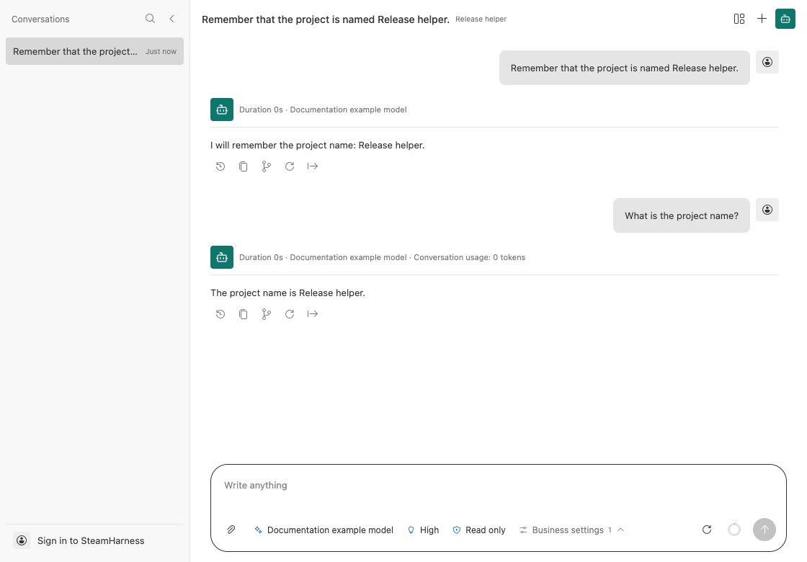

# Build a Bot

Create a Bot project in Studio, install its dependencies, and configure an available model. Use `engine: "llm"` for replies based on the current conversation, or `engine: "agent"` for tools, project memory, and durable recovery.

## Declare the entry

Put this code in the Bot entry file. This Agent example adds one business parameter; Core supplies the model, Effort, Plan, and permission controls.

```ts
import type { RuntimeApi } from "steamharness/runtime-api";
declare const steamharness: RuntimeApi;

export const executor = steamharness.defineBot({
  engine: "agent",
  name: "Release helper",
  agent: { tools: [], systemPrompt: "You are a project assistant. Answer from the current conversation." },
  params: [{
    kind: "auxiliary", id: "business", label: "Business settings",
    fields: [{ name: "projectName", flag: "--project-name", type: "string", defaultValue: "Release helper" }],
  }],
  prepareInput(input, context) {
    return { ...input, systemPrompt: `You are a project assistant. The project is named ${context.paramValues.projectName}. Answer from the current conversation.` };
  },
});
export default executor;
```

Register the entry with `type: "bot"` in `steamharness.json`. Keep the project UUID and entry ID created by the project template.

For model-only replies, replace the entry declaration with the following. Both engines use the same model settings, so no separate LLM credential is needed.

```ts
export const executor = steamharness.defineBot({
  engine: "llm",
  llm: { systemPrompt: "You are a project assistant. Answer from the current conversation." },
});
export default executor;
```

## Verify a continuing conversation

1. Open the run page and select an available model.
2. Send “Remember that the project is named Release helper.”
3. Ask “What is the project name?” in the same conversation and check whether the reply uses the earlier message.
4. Close and reopen the project, then confirm that the history remains available.



Continuing messages in one Bot conversation. The replies shown are examples.

## Input, output, and business hooks

| Setting | Purpose |
| --- | --- |
| `agent` | Prompts, model source, permissions, skills, and tool extensions |
| `llm` | Prompt, model source, and output settings; one model call per turn |
| `params` | Append business fields; customize built-in fields through `agent.paramOptions` |
| `prepareInput(input, context)` | Add business context after Core parses text and images |
| `onCompleted(result, context)` | Persist a receipt after success and return `void` |

Both engines provide output, history, usage, and queues. Approval and automatic recovery are Agent-only. The final answer item is `agent-answer`. A Bot cannot replace `workflow`, `createInput`, or the output type.

Persist completion receipts idempotently using `result.requestId`. If notification fails, retrying the same request retries the notification without another model call.

Use `--entry` to select a Bot in an aggregate; `--entrypoint` applies to Workflow only. See [defineBot](/en/core-api/define-bot) for the contract and [assistant tasks](/en/guides/studio/assistant) for queue and recovery controls.
