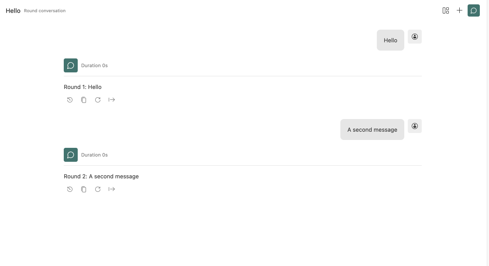

# Build a Conversation

A Conversation runs its executor for each incoming message. Use it for assistants that need continuing context. Start by creating the round-conversation template and completing project setup.

## A conversation without a model

The template reads existing messages, emits the next round number, and saves the input and reply:

```ts
import type { RuntimeApi } from 'steamharness/runtime-api';

const steamharness = (globalThis as unknown as { steamharness: RuntimeApi }).steamharness;
const answer = steamharness.createOutputNode<{ message: string }, unknown>({
  name: 'round-answer',
  async *stream(input, context) {
    const history = await context.conversation.getValue();
    const round = history.messages.filter(message => message.role === 'assistant').length + 1;
    const text = `Round ${round}: ${input.message}`;
    yield steamharness.createOutputItemChunk({ type: 'output_item_start', item: { id: 'answer', title: 'Output', contentType: 'markdown', content: '', collapsed: false } });
    yield steamharness.createOutputItemChunk({ type: 'output_item_delta', itemId: 'answer', delta: text });
    yield steamharness.createOutputItemChunk({ type: 'output_item_end', itemId: 'answer' });
    await context.conversation.appendMessage({ role: 'user', content: input.message });
    await context.conversation.appendMessage({ role: 'assistant', content: text });
  },
  format: stream => steamharness.createOutputPayload({ items: stream.items }),
});
const conversation = steamharness.defineProject<{ message: string }, unknown>({
  name: 'round-conversation',
  async run(input, context) { return (await steamharness.runStreamNode(answer, input, context)).output; },
});
export const executor = steamharness.defineExecutor({
  projectType: 'conversation', workflow: conversation,
  createInput: context => ({ message: steamharness.parseConversationDefaultInputArgs(context.args).message }),
});
```

1. Open the run page and send `Hello`.
2. Confirm that the reply includes `Round 1` and your text.
3. Send another message and check that the round advances to `Round 2`.

The example generates text directly, so it needs no model credentials. It explicitly appends both user and assistant messages to the conversation.




Two messages in one conversation produce Round 1 and Round 2.

## Input and history

| Part | Purpose |
| --- | --- |
| `parseConversationDefaultInputArgs` | Reads the current message from executor arguments |
| `context.conversation.getValue()` | Reads the current conversation snapshot |
| `appendMessage()` | Saves a user or assistant message |
| Output item chunks | Streams content into the UI |

A Conversation executor uses `workflow` and `createInput` instead of Workflow `entrypoints`. You can select a Conversation aggregate entry with `--entry`, but it does not accept the Workflow operation option `--entrypoint`.

## Turn it into a model assistant

For tool calls, permissions, context compaction, and durable recovery, use [defineAgentConversationExecutor](/en/core-api/define-agent-conversation-executor) and [createAgent](/en/core-api/create-agent). Configure an available model before choosing tools and approval policies.

See [databases and conversations](/en/concepts/database-and-conversation) for history and configuration isolation, and [assistant tasks](/en/guides/studio/assistant) for queues and child tasks.
