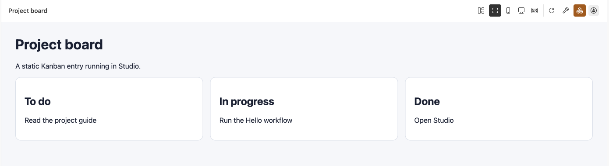

# Build a Kanban

A Kanban entry consists of HTML, CSS, JavaScript, and static assets. This static example shows how to declare and build one.

## Display a static page

Add this `index.html` to an already registered project:

```html
<!doctype html>
<html lang="en">
<meta charset="utf-8">
<meta name="viewport" content="width=device-width, initial-scale=1">
<title>Project board</title>
<style>
  body { font: 16px system-ui; margin: 32px; background: #f5f7fa; color: #172033; }
  main { display: grid; gap: 16px; grid-template-columns: repeat(auto-fit, minmax(220px, 1fr)); }
  article { padding: 20px; border: 1px solid #d9e0ea; border-radius: 12px; background: white; }
</style>
<h1>Project board</h1>
<p>A static Kanban entry running in Studio.</p>
<main>
  <article><h2>To do</h2><p>Read the project guide</p></article>
  <article><h2>In progress</h2><p>Run the Hello workflow</p></article>
  <article><h2>Done</h2><p>Open Studio</p></article>
</main>
</html>
```

Add the following entry to the root manifest's `entries`, retaining the existing project ID, version, and other entries:

```json
{
  "entryId": "board",
  "type": "kanban",
  "name": "Project board",
  "root": ".",
  "entry": "index.html"
}
```

Run `pnpm exec steamharness check .`, then open `board` from Studio's entry panel. It should display three static columns. This example does not persist data.




A three-column static board.

## Use a build tool

When bundling JavaScript or styles, build locally and point the entry at the resulting HTML. Use relative asset paths and distribute the assets in the project archive. Server does not run project build scripts.

## Integrate with the host

See [Kanban HTML projects](/en/concepts/kanban) for configuration, page methods, conversation subscriptions, and Workflow calls. Browser pages receive no long-lived host credentials.
