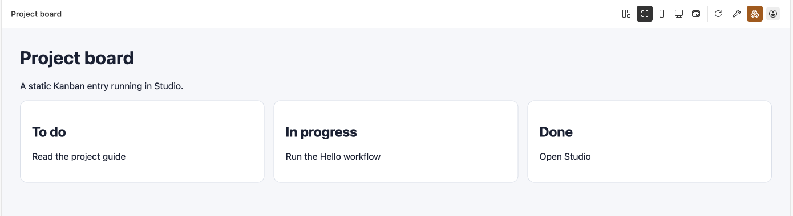

# Build a Kanban

A Kanban entry consists of HTML, CSS, JavaScript, and static assets. Begin with a static page, then configure relational storage for data that needs persistence.

## Display a static page

Add this `index.html` to an already registered project:

```html
<!doctype html>
<html lang="en">
<meta charset="utf-8">
<meta name="viewport" content="width=device-width, initial-scale=1">
<title>Project board</title>
<style>
  body { font: 16px system-ui; margin: 32px; background: #f5f7fa; color: #172033; }
  main { display: grid; gap: 16px; grid-template-columns: repeat(auto-fit, minmax(220px, 1fr)); }
  article { padding: 20px; border: 1px solid #d9e0ea; border-radius: 12px; background: white; }
</style>
<h1>Project board</h1>
<p>A static Kanban entry running in Studio.</p>
<main>
  <article><h2>To do</h2><p>Read the project guide</p></article>
  <article><h2>In progress</h2><p>Run the Hello workflow</p></article>
  <article><h2>Done</h2><p>Open Studio</p></article>
</main>
</html>
```

Add the following entry to the root manifest's `entries`, retaining the existing project ID, version, and other entries:

```json
{
  "entryId": "board",
  "type": "kanban",
  "name": "Project board",
  "root": ".",
  "entry": "index.html",
  "databases": []
}
```

Run `pnpm exec steamharness check .`, then open `board` from Studio's entry panel. It should display three static columns. This example does not persist data.




A three-column static board with no business-database operations.

## Use a build tool

When bundling JavaScript or styles, build locally and point the entry at the resulting HTML. Use relative asset paths and distribute the assets in the project archive. Server does not run project build scripts.

## Persist business data

The basic-board template uses relational `Task` rows scoped by configuration ID. Prepare it before use:

1. Install dependencies and run `steamharness database generate`.
2. Explicitly create a resource and bind the entry's `data` alias.
3. Apply the model migration and check Server and PostgreSQL connectivity.
4. Build, open the page, and verify reads and writes.

Read failures disable editing. Concurrent writes check row versions, and multi-row edits are separate operations. The template neither allocates databases automatically nor falls back to local storage.

## Integrate with the host

See [Kanban HTML projects](/en/concepts/kanban) for configuration, data Bridge calls, page methods, conversation subscriptions, and Workflow calls. Browser pages receive no long-lived host credentials. Resource authorization and entry bindings apply to every data operation.
