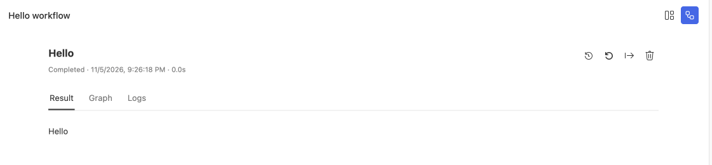

# Build a Workflow

A Workflow passes input through nodes and returns a standard run result. Create a Hello workflow in Studio, complete setup, and open `index.ts`.

## A minimal runnable entry

This is the complete Hello executor. It needs neither a model nor a business database:

```ts
import type { RuntimeApi } from 'steamharness/runtime-api';

const steamharness = (globalThis as unknown as { steamharness: RuntimeApi }).steamharness;
const answer = steamharness.createOutputNode({
  name: 'hello', async *stream() { yield 'Hello'; },
  format: stream => steamharness.createOutputPayload({ items: stream.items }),
});
const helloProject = steamharness.defineProject({
  name: 'hello',
  async run(input, context) {
    return (await steamharness.runStreamNode(answer, input, context)).output;
  },
});
export const executor = steamharness.defineExecutor({
  projectType: 'workflow', defaultEntrypoint: 'main',
  entrypoints: [steamharness.defineEntrypoint({ id: 'main', title: 'Hello', workflow: helloProject, createInput: () => ({ errCode: 0, errMessage: '' }) })],
});
```

| Part | Purpose |
| --- | --- |
| `globalThis.steamharness` | Host-injected Runtime API; import its type from `steamharness/runtime-api` |
| `createOutputNode` | Defines a streaming output node that emits `Hello` |
| `defineProject` | Defines the workflow body and connects nodes in `run` |
| `defineEntrypoint` | Declares an operation ID, title, and input constructor |
| `defineExecutor` | Exports the executor that the runtime loads |

Change the text in `yield 'Hello'`, save, and run again to inspect the new output.




Check workflow status and output in Studio.

## Validate and run

The root `steamharness.json` points `entries` at executor files and uses `defaultEntry` to select a project entry. Within a Workflow executor, `defaultEntrypoint` selects one of its operations.

```sh
pnpm exec steamharness check .
pnpm exec steamharness structure .
pnpm exec steamharness run . --entry main --entrypoint main
```

`--entry` selects the aggregate entry; `--entrypoint` selects its Workflow operation. An explicit unknown ID fails instead of falling back to the default.

## Accept business input

Declare UI fields in an operation's `params`, then convert them to workflow input with `createInput(context)`. See [defineExecutor](/en/core-api/define-executor) for fields and dynamic parameters, and [defineEntrypoint](/en/core-api/define-entrypoint) for operation declarations.

Parameters, tools, and registry entries belong to individual operations. Static analysis must be able to read the entry array, IDs, titles, and default operation from source. Do not construct them dynamically at runtime.

## Extend the workflow

| Capability | API |
| --- | --- |
| Ordinary nodes | [runNode](/en/core-api/run-node) |
| Streaming nodes | [runStreamNode](/en/core-api/run-stream-node) |
| Branches and loops | [runIf](/en/core-api/run-if), [runFor](/en/core-api/run-for), [runWhile](/en/core-api/run-while) |
| Model calls | [createLLMNode](/en/core-api/create-llm-node) |
| Durable Agents | [createAgent](/en/core-api/create-agent) |

Business output retains the `errCode` and `errMessage` protocol. Use Trace to inspect inputs, outputs, and errors when a run fails. See [payloads and errors](/en/concepts/payloads-and-errors).
