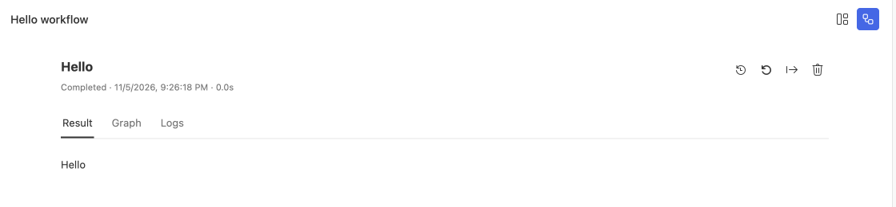

# Run your first project

Use the Hello workflow to check Studio, project dependencies, and local execution. The example emits fixed text and needs no model API key.

## Before you start

| Requirement | What to check |
| --- | --- |
| Studio | The workbench opens; see [installation and startup](/en/guides/studio/installation) for source builds |
| Server account | Project creation requires sign-in and a reachable Server |
| Network | The first dependency installation needs access to the npm registry |
| Destination | Choose a writable parent directory with no existing target folder |

## Create a Hello workflow

1. On the Studio start page, select **New Project**.
2. Choose **Workflow**, then the **Hello workflow** example.
3. Enter `hello-docs` and confirm the parent directory.
4. Select **Create**, then choose the current window or a new window.
5. Wait for dependency installation and project validation.

Studio generates source and opens the project window, then installs dependencies, requests a project ID, and validates the project. Canceling the window choice creates no files. Later failures keep the source in place; use **View installation log** or **Retry project setup** in the project window.

## Run and inspect the result

1. Select **Run Project** to open the default entry.
2. Start the workflow from its run page.
3. Check that the output contains `Hello` and inspect the run status.
4. Open Trace to inspect the node and output records.

If the run button is missing, open the project root containing `steamharness.json`. Setup guidance appears only when a check fails. Fix the reported issue and select **Check again**.

## Verify from the terminal

Run these commands in the project directory to use its installed CLI:

```sh
pnpm exec steamharness check .
pnpm exec steamharness structure .
pnpm exec steamharness run .
```

`check` validates entry declarations, `structure` shows the execution structure, and `run` executes the default entry. For a machine-readable result, use [`steamharness json`](/en/cli/steamharness/json).




The result of running the Hello example.

## Continue

| Your next task | Guide |
| --- | --- |
| Process input through several steps | [Build a Workflow](/en/guides/development/workflow) |
| Send messages and keep history | [Build a Bot](/en/guides/development/conversation) |
| Display a static page or data board | [Build a Kanban](/en/guides/development/kanban) |
| Connect a model | [Model settings](/en/guides/studio/models) |
| Share a project | [Uploads, downloads, and versions](/en/guides/studio/versions) |

The basic board template requires Server, PostgreSQL, and an entry database binding. Start with this Hello workflow before setting up a data-backed board.
