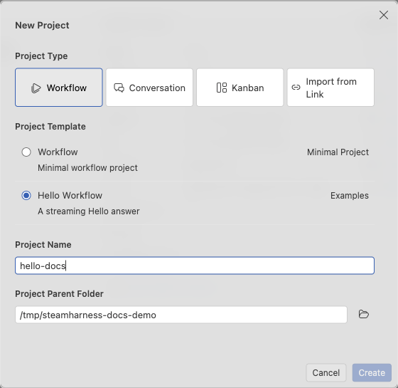

# Create and import projects

Create a project from the start page or open existing source. A project can register several Workflow, Conversation, and Kanban entries.

Select the Hello workflow template and enter its name and parent directory.

## Create from a template

1. Select **New Project**, then choose a project type and template.
2. Enter a name and parent directory. The default is `Documents/steamharness-projects` under your home directory. The target folder must not exist.
3. Select **Create** and choose the current window or a new window. Canceling this choice creates no files.
4. In the destination window, wait for dependencies, registration, and validation.

Studio generates local source, opens the project window, installs dependencies, requests a Server project ID using your account, and validates the project. It prefers pnpm and falls back to npm. Templates pin compatible Core and CLI versions.

| Template | Result and requirements |
| --- | --- |
| Hello workflow | Streams `Hello` without calling a model |
| Round conversation | Saves history and replies with the round number without a model |
| Basic board | Manages tasks; requires a relational database, schema migration, and entry binding |
| Parameterized board | Configures the title and completed column through parameters; set up the resources declared by the template |

## Resume failed setup

Dependency installation, registration, and validation have separate statuses. A failure or cancellation keeps the source. Reloading the window does not retry setup automatically.

1. Select **View installation log** to open the persistent `installation.log`.
2. Fix the network, sign-in, or declaration problem.
3. Select **Retry project setup**. Installed dependencies and an already allocated project ID are reused.

Registration requires sign-in; sign in and retry if it failed. If the registration account changed, follow the prompt to use the appropriate account. Applying for a new identity does not transfer old data grants: request access and bind the resources again.

## Open existing source

1. Select **Open Folder** and choose the directory containing the root `steamharness.json`, or open a `.code-workspace`.
2. Choose the current window or a new window.
3. Install the project's dependencies, then select **Run Project**.

A new window preserves the original window and unsaved files. Opening in the current window retains the editor's save prompts. Recent projects can be reopened or removed; deleted directories are removed from the registry automatically.

## Import a share link

Under **New Project → Import from link**, paste a Server Web version share link and select **Import**. The import uses the default project directory without a template or project name. It remains available when the template list cannot load.

A private project may require approved guest access. After downloading, install dependencies and check the current account's database and knowledge grants. See [uploads, downloads, and versions](/en/guides/studio/versions).
