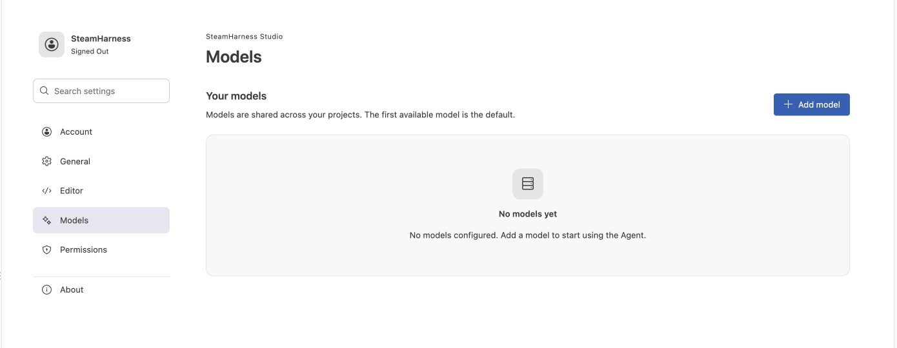

# Configure models

Manage models shared across workspaces in **Settings → Models**. The open-source edition uses custom models and keeps their credentials in local secure storage.

Add custom models on the Models settings page.

## Add and select a model

1. Open **Settings → Models**, or select **Configure model** in the assistant.
2. Add a custom model with its provider, endpoint, and required credentials.
3. Save and select an available model from the model menu.
4. Choose a supported reasoning effort separately.

When no model is available, the assistant shows the configuration entry. The model list returns after configuration. The assistant defaults to the first permitted model; any available model can be set as the default.

## Edit and apply changes

| Action | Behavior |
| --- | --- |
| Add, edit, or delete a custom model | Use the model table |
| Navigate a dialog | Tab moves between fields; Esc cancels |
| Open settings during a task | Editing is available; the current task keeps its snapshot |
| Save configuration | Changes apply after current and background work ends and the conversation is idle |
| Resolve a concurrent edit | Reopen the editor and edit the latest data |

The table contains model, provider, and action columns. On narrow windows only the table scrolls horizontally. Model selection and reasoning effort remain separate.

## System models

Hosts that support system AI load the current account's available models and group built-in and custom entries separately. Built-in models can be refreshed or made the default, but cannot be edited or deleted manually.

Switching accounts clears the old catalog. An ordinary refresh failure preserves the current list and allows retry. See the [enhanced guide](https://docs.steamharness.yuhe.space/en/enhanced/ai/user-guide) for system AI access.

## Troubleshooting

- Empty list: check custom model configuration or the account's system-model access.
- A setting did not affect the current reply: wait for current and background tasks to finish before sending again.
- A model is not allowed by the project: check the project's model-source and user-settings declarations.

Developer integration is covered in [user settings and permissions](/en/core-api/user-settings) and [LLM Provider](/en/concepts/llm-provider).
