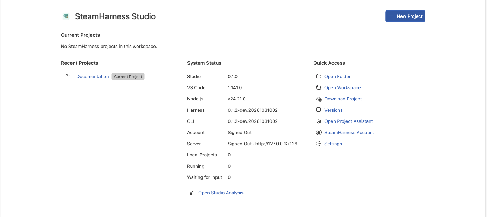

# SteamHarness Studio

Studio is a workbench for editing and running SteamHarness projects. Complete the [quickstart](/en/guides/quickstart), then choose a guide for your current task.

Studio start page with projects, recent folders, and common actions.

## IDE and Steam modes

Switch layouts and manage tool instances, files, and shortcuts.

[Read the guide](/en/guides/studio/interface)

## Start workbench

Create from a template or import a folder, workspace, or share link.

[Read the guide](/en/guides/studio/create-import)

## Open a Workflow project

Open the run UI, select an entry and parameters, and inspect results in Trace.

[Read the guide](/en/guides/studio/run-debug)

## Aggregate entries and databases

Obtain resource grants and bind entry aliases before using databases or knowledge bases.

[Read the guide](/en/guides/studio/data)

## Uploads, downloads, and versions

Upload and publish a complete project, or download a chosen version.

[Read the guide](/en/guides/studio/versions)

## Local analysis

Filter local projects and runs to inspect status, success rate, and duration.

[Read the guide](/en/guides/studio/analysis)

## Accounts and servers

Choose a Server, sign in, and check project identity, ownership, and access.

[Read the guide](/en/guides/studio/configuration)

## Run from source

Install dependencies, build, and launch the desktop or browser workbench.

[Read the guide](/en/guides/studio/installation)

## Project configurations

Choose named configurations, edit fields, and import or export settings.

[Read the guide](/en/guides/studio/configuration)

## Model settings

Add models, choose defaults, and understand when settings apply.

[Read the guide](/en/guides/studio/models)

## Assistant and permissions

Use skills, control tools, and durable tasks; inspect permissions and child Agents.

[Read the guide](/en/guides/studio/assistant)
