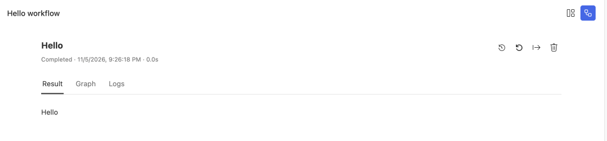

# Run projects and inspect errors

Select **Run Project** to open the project UI, then choose the entry to execute. Studio uses the project's installed `steamharness` and `@steamharness/cli`.

The Hello workflow completed and displays its local output.

## Run a task

1. Open the project root and install its dependencies.
2. Select **Run Project** in the title bar or start page.
3. For Workflow, choose an operation, fill parameters, and run. For Conversation, send a message. For Kanban, open the page.
4. Inspect the output and status; open Trace when you need diagnostics.

Successful background checks stay silent. A failed check shows guidance and **Check again**. The guidance disappears after a successful retry.

## Open another entry

Each start-page card represents one aggregate project and opens `defaultEntry`. The **Project windows** button in the run UI lists all entries and their statuses.

The open button creates a new tab each time, including for the current entry. Tabs retain independent page state and drafts and can restore after restart. Tabs for the same project share a host process, which is released after the last native tab closes.

The **Open Project Window** view lists only the current project. It survives tool switches and refreshes after declaration changes; manual refresh is also available. Tab titles use “Project / Entry”; the version belongs to the whole project.

## Read Trace

| What to inspect | Where to look |
| --- | --- |
| Node input, output, and logs | Select the node in the execution trace |
| Model or tool failures | Filter **Errors** by conversation, round, or keyword |
| Task trees and child conversations | Select a task or open its child conversation |
| Context and usage | Open Usage or hover over the context indicator beside the input |

Earlier diagnostics remain after a successful model retry. Selecting Trace history does not switch the conversation body. The eye marker follows the conversation actually open in the editor.

Parameter, attachment, and resource errors remain beside the relevant action. Dismissing a message does not bypass parameter validation. In short windows, input text and attachments scroll while send controls stay visible.

## Close and resume

Saved history is available when you reopen a project. Ordinary runs follow their host's close and stop behavior. Durable Agents save checkpoints and persist cancellation only after an explicit stop; see [the assistant and durable tasks](/en/guides/studio/assistant).

For database failures, check [resource grants and entry bindings](/en/guides/studio/data). A successful upload or file download does not prove that a page rendered. Open the Kanban and inspect its content.
