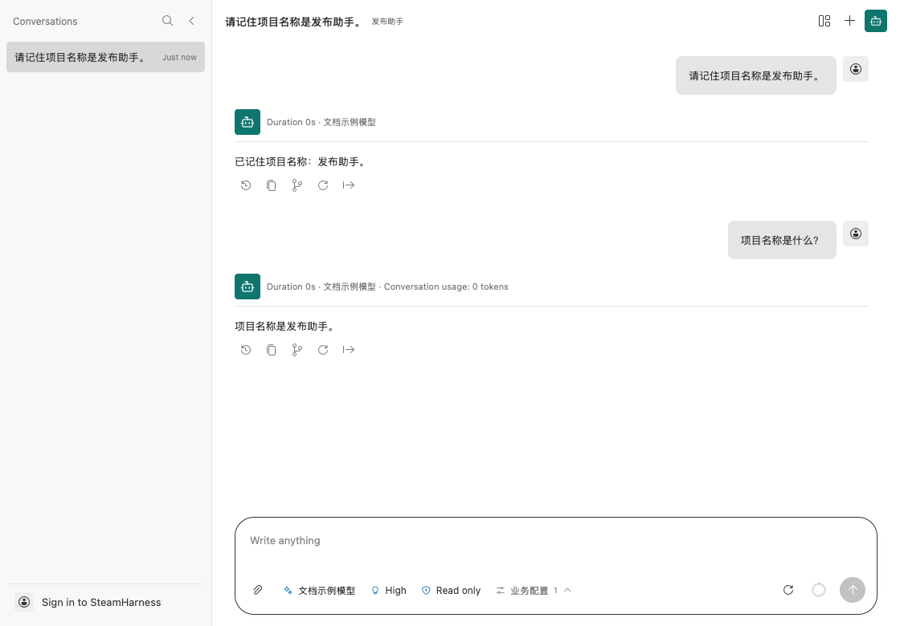

# 编写一个 Bot

先在 Studio 新建 Bot 项目，安装依赖，并配置一个可用模型。只需要针对本会话回答时选择 `engine: "llm"`；需要工具、项目记忆或持久恢复时选择 `engine: "agent"`。

## 声明入口

把下面的代码放入 Bot 入口文件。这个 Agent 示例追加一个业务参数；模型、Effort、Plan 和权限控件由 Core 提供。

```ts
import type { RuntimeApi } from "steamharness/runtime-api";
declare const steamharness: RuntimeApi;

export const executor = steamharness.defineBot({
  engine: "agent",
  name: "发布助手",
  agent: { tools: [], systemPrompt: "你是项目助手，请根据当前会话回答。" },
  params: [{
    kind: "auxiliary", id: "business", label: "业务配置",
    fields: [{ name: "projectName", flag: "--project-name", type: "string", defaultValue: "发布助手" }],
  }],
  prepareInput(input, context) {
    return { ...input, systemPrompt: `你是项目助手。项目名称是${context.paramValues.projectName}。请根据当前会话回答。` };
  },
});
export default executor;
```

入口在 `steamharness.json` 中注册为 `type: "bot"`。保留创建项目时生成的项目 UUID 和入口 ID。

如果 Bot 能在源码目录之外处理文件，在该 Bot 的入口声明中加上 `"folderContext": true`。聚合项目把这个字段写在对应入口的独立 `steamharness.json` 中。本机宿主传入目录时，`prepareInput(input, context)` 可从 `context.folderContext?.directory` 读取规范化的绝对路径；没有传入时，该字段为 `undefined`。Agent Bot 的内置工具使用该目录作为工作目录。这个字段不会改变项目源码目录，也不会把工具限制在该目录内。

如果只需模型回答，把入口声明替换为以下代码。两种引擎使用相同的模型设置，不必为 LLM 另配凭据。

```ts
export const executor = steamharness.defineBot({
  engine: "llm",
  llm: { systemPrompt: "你是项目助手，请根据当前会话回答。" },
});
export default executor;
```

## 验证连续对话

1. 打开运行页面，确认已选择可用模型。
2. 发送“请记住项目名称是发布助手”。
3. 在同一会话中继续问“项目名称是什么？”，核对回复是否利用了前文。
4. 关闭并重新打开项目，确认历史仍可读取。



同一 Bot 会话中的连续消息。截图中的答复仅作示例。

## 输入、输出与业务处理

| 配置 | 用途 |
| --- | --- |
| `agent` | 提示词、模型来源、权限、技能和工具扩展 |
| `llm` | 提示词、模型来源和输出设置；每轮只调用模型一次 |
| `params` | 追加业务字段；内置字段通过 `agent.paramOptions` 定制 |
| `prepareInput(input, context)` | 在 Core 解析文本和图片后补充业务上下文 |
| `onCompleted(result, context)` | 成功后保存业务回执，返回 `void` |

两种引擎均提供输出、会话历史、用量和队列；审批和自动恢复仅适用于 Agent。最终正文标识为 `agent-answer`。Bot 不能替换 `workflow`、`createInput` 或输出类型。

完成通知应按 `result.requestId` 幂等保存。通知失败后，重试同一请求只补跑通知，不会再次调用模型。

聚合项目用 `--entry` 选择 Bot；`--entrypoint` 只适用于 Workflow。完整开发契约见 [defineBot](/core-api/define-bot)，队列与恢复操作见[小助手与持久任务](/guides/studio/assistant)。
