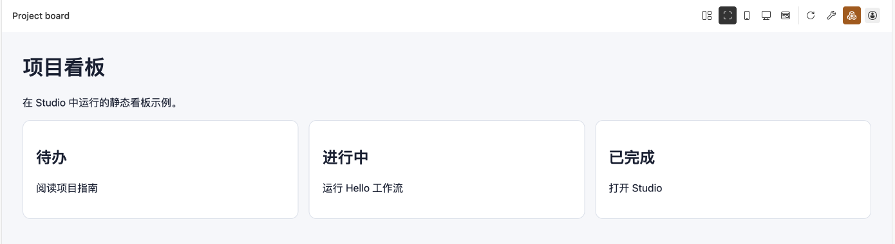

# 编写一个 Kanban

Kanban 是 HTML、CSS、JavaScript 和静态资源组成的项目入口。先显示一个静态页面，再为需要保存的数据配置关系库。

## 显示静态页面

在已注册项目中添加 `index.html`，内容如下：

```html
<!doctype html>
<html lang="zh-CN">
<meta charset="utf-8">
<meta name="viewport" content="width=device-width, initial-scale=1">
<title>项目看板</title>
<style>
  body { font: 16px system-ui; margin: 32px; background: #f5f7fa; color: #172033; }
  main { display: grid; gap: 16px; grid-template-columns: repeat(auto-fit, minmax(220px, 1fr)); }
  article { padding: 20px; border: 1px solid #d9e0ea; border-radius: 12px; background: white; }
</style>
<h1>项目看板</h1>
<p>在 Studio 中运行的静态看板示例。</p>
<main>
  <article><h2>待办</h2><p>阅读项目指南</p></article>
  <article><h2>进行中</h2><p>运行 Hello 工作流</p></article>
  <article><h2>已完成</h2><p>打开 Studio</p></article>
</main>
</html>
```

在根清单的 `entries` 中声明这个入口，保留原有项目 ID、版本和其他入口：

```json
{
  "entryId": "board",
  "type": "kanban",
  "name": "Project board",
  "root": ".",
  "entry": "index.html",
  "databases": []
}
```

运行 `pnpm exec steamharness check .`，再从 Studio 的入口面板打开 `board`。应显示三列静态内容；这个页面没有持久化操作。




三列静态看板示例，不读写业务数据库。

## 使用构建工具

需要打包 JavaScript 或样式时，先本地构建，再把入口指向构建后的 HTML。静态资源使用相对路径，随项目归档一起分发。Server 不替项目执行构建脚本。

## 保存业务数据

基础看板模板使用关系型 `Task` 表，按配置 ID 区分任务。使用前完成以下步骤：

1. 安装依赖，执行 `steamharness database generate`。
2. 显式创建资源，为入口绑定 `data` 别名。
3. 执行模型迁移，确认 Server 与 PostgreSQL 可达。
4. 构建并打开页面，验证读取与修改结果。

读取失败时页面会禁止编辑；并发写入使用行版本检查，多行编辑是独立操作。模板不会自动申请数据库或回退到本地存储。

## 接入宿主

配置、数据 Bridge、页面方法、对话订阅和其他 Workflow 调用见 [Kanban HTML 项目](/concepts/kanban)。浏览器页面不能获得宿主长期凭据；每次数据调用仍受资源授权和入口绑定约束。
