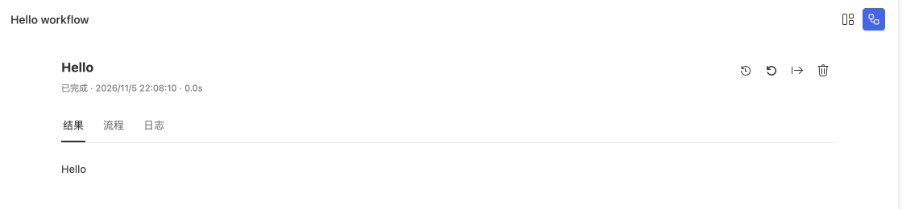

# 编写一个 Workflow

Workflow 把输入交给节点，再返回统一的运行结果。先在 Studio 创建 Hello 工作流并完成项目设置，然后打开 `index.ts`。

## 最小可运行入口

下面是 Hello 模板的完整执行器，不需要模型或业务数据库：

```ts
import type { RuntimeApi } from 'steamharness/runtime-api';

const steamharness = (globalThis as unknown as { steamharness: RuntimeApi }).steamharness;
const answer = steamharness.createOutputNode({
  name: 'hello', async *stream() { yield 'Hello'; },
  format: stream => steamharness.createOutputPayload({ items: stream.items }),
});
const helloProject = steamharness.defineProject({
  name: 'hello',
  async run(input, context) {
    return (await steamharness.runStreamNode(answer, input, context)).output;
  },
});
export const executor = steamharness.defineExecutor({
  projectType: 'workflow', defaultEntrypoint: 'main',
  entrypoints: [steamharness.defineEntrypoint({ id: 'main', title: 'Hello', workflow: helloProject, createInput: () => ({ errCode: 0, errMessage: '' }) })],
});
```

| 部分 | 作用 |
| --- | --- |
| `globalThis.steamharness` | 宿主注入的 Runtime API；类型从 `steamharness/runtime-api` 导入 |
| `createOutputNode` | 定义流式输出节点，这里输出 `Hello` |
| `defineProject` | 声明工作流主体，在 `run` 中连接节点 |
| `defineEntrypoint` | 为工作流操作声明 ID、标题和输入构造 |
| `defineExecutor` | 导出运行时可加载的执行器 |

修改 `yield 'Hello'` 的文字，保存后重新运行，即可看到新的输出。




在 Studio 中核对工作流状态与输出。

## 检查声明与运行

根 `steamharness.json` 的 `entries` 指向执行器文件，`defaultEntry` 选择默认项目入口。Workflow 执行器内部还可定义多个操作，由 `defaultEntrypoint` 选择默认操作。

```sh
pnpm exec steamharness check .
pnpm exec steamharness structure .
pnpm exec steamharness run . --entry main --entrypoint main
```

`--entry` 选择聚合入口，`--entrypoint` 选择其中的 Workflow 操作。显式指定未知 ID 会报错，不会回退到默认项。

## 接入业务输入

在操作的 `params` 中声明界面字段，再由 `createInput(context)` 把参数转换为工作流输入。字段与联动规则见 [defineExecutor](/core-api/define-executor)，操作声明见 [defineEntrypoint](/core-api/define-entrypoint)。

参数、工具和 registry 放在具体操作中。静态结构检查要求入口数组、ID、标题和默认操作可以直接从源码读取，不能用运行时动态代码生成。

## 扩展流程

| 需要的能力 | API |
| --- | --- |
| 普通节点 | [runNode](/core-api/run-node) |
| 流式节点 | [runStreamNode](/core-api/run-stream-node) |
| 分支和循环 | [runIf](/core-api/run-if)、[runFor](/core-api/run-for)、[runWhile](/core-api/run-while) |
| 调用模型 | [createLLMNode](/core-api/create-llm-node) |
| 持久 Agent | [createAgent](/core-api/create-agent) |

业务输出保留 `errCode` 与 `errMessage` 协议；出现异常时到 Trace 查看节点输入、输出与错误，详见 [Payload 与错误](/concepts/payloads-and-errors)。
