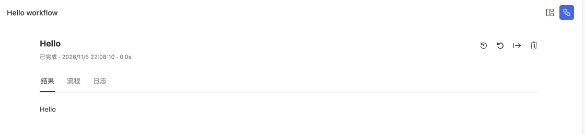

# 运行第一个项目

本教程使用 Hello 工作流验证 Studio、项目依赖和本地运行。示例输出固定文字，不需要模型 API Key。

## 开始前

| 准备项 | 要求 |
| --- | --- |
| Studio | 能打开工作台；源码启动步骤见[安装与启动](/guides/studio/installation) |
| Server 账号 | 创建项目时需要登录，并能连接所选 Server |
| 网络 | 首次安装依赖需要访问 npm 包仓库 |
| 保存目录 | 选择可写目录，目标项目文件夹尚不存在 |

## 创建 Hello 工作流

1. 在 Studio 开始页点击 **新建项目**。
2. 选择 **Workflow**，再选择 **Hello 工作流**示例。
3. 输入名称 `hello-docs`，确认父目录。
4. 点击 **创建**，选择在当前窗口或新窗口打开。
5. 等待依赖安装与项目校验完成。

Studio 先生成源码并打开项目窗口，再安装依赖、申请项目 ID 和校验项目。取消窗口选择不会生成文件；后续步骤失败会保留源码，可以点击 **查看安装日志** 或 **重试项目设置**。

## 运行并检查结果

1. 点击 **运行项目**，打开默认入口。
2. 在运行页面启动工作流。
3. 确认输出区域显示 `Hello`，并查看本次运行的状态。
4. 打开 Trace，检查节点及输出记录。

没有出现运行按钮时，确认打开的是含 `steamharness.json` 的项目根目录。仅检查失败时会显示处理引导，修复后点击 **重新检查**。

## 从终端验证

在项目目录执行以下命令，使用项目安装的 CLI：

```sh
pnpm exec steamharness check .
pnpm exec steamharness structure .
pnpm exec steamharness run .
```

`check` 检查入口声明，`structure` 展示执行结构，`run` 执行默认入口。需要机器可读结果时，改用 [`steamharness json`](/cli/steamharness/json)。




第一次运行 Hello 示例后的结果。

## 继续尝试

| 想做的事 | 下一篇 |
| --- | --- |
| 输入内容并分步骤处理 | [编写 Workflow](/guides/development/workflow) |
| 连续发送消息并保留历史 | [编写 Conversation](/guides/development/conversation) |
| 显示静态页面或数据看板 | [编写 Kanban](/guides/development/kanban) |
| 接入模型 | [模型设置](/guides/studio/models) |
| 把项目交给其他人 | [上传、下载与版本](/guides/studio/versions) |

基础看板模板需要 Server、PostgreSQL 和入口数据库绑定。它不是离线无依赖示例；首次体验建议先完成本页的 Hello 工作流。
