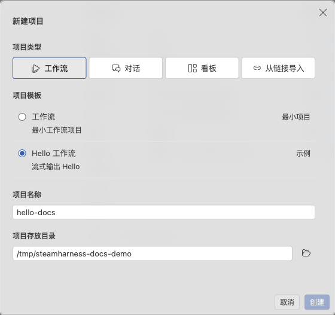

# 创建与导入项目

在开始页创建项目，或打开已有源码。一个项目可以注册多个 Workflow、Conversation 和 Kanban 入口。

选择 Hello 工作流模板，填写名称和保存目录。

## 从模板创建

1. 点击 **新建项目**，选择项目类型及模板。
2. 输入项目名称和父目录。默认父目录为用户主目录下的 `Documents/steamharness-projects`；目标文件夹必须尚不存在。
3. 点击 **创建**，选择当前窗口或新窗口。取消窗口选择不会生成文件。
4. 在目标窗口等待依赖安装、项目注册和校验完成。

Studio 先生成本地源码，再在打开的项目窗口安装依赖，登录 Server 申请项目 ID，最后校验项目。依赖优先用 pnpm 安装，没有 pnpm 时使用 npm，模板固定使用兼容的 Core 与 CLI 版本。

| 模板 | 运行结果与前提 |
| --- | --- |
| Hello 工作流 | 流式输出 `Hello`，不调用模型 |
| 轮次对话 | 保存历史并回复轮次，不调用模型 |
| 基础看板 | 管理任务；需创建关系库、迁移模型并绑定入口 |
| 参数化看板 | 通过参数调整标题和完成列；按模板声明配置数据资源 |

## 设置失败后继续

依赖安装、注册和校验分别显示状态。失败或取消后保留源码；重载窗口不会自行重试。

1. 点击 **查看安装日志**，查看持久保存的 `installation.log`。
2. 处理网络、登录或声明问题。
3. 点击 **重试项目设置**。已成功安装的依赖会复用，已取得的项目 ID 也会保留。

未登录时，项目注册会失败，可以登录后重试。申请 ID 使用的账号发生变化时，按提示切回相应账号。重新申请身份不会转移旧身份的数据授权，需要重新绑定或申请资源权限。

## 打开现有项目

1. 选择 **打开文件夹**，定位含根 `steamharness.json` 的目录；也可打开 `.code-workspace`。
2. 选择在当前窗口或新窗口打开。
3. 安装项目自己的依赖，再点击 **运行项目**。

选择新窗口会保留原窗口和未保存文件；当前窗口继续使用编辑器的保存确认。最近项目可以重新打开或移除，已删除的目录会自动清理登记。

## 从分享链接导入

在 **新建项目 → 从链接导入** 中粘贴 Server Web 的版本分享链接，点击 **导入**。此流程使用默认项目目录，无需选择模板或填写名称；模板列表不可用时仍可使用。

私有项目可能需要先申请访客权限。下载后仍需安装依赖，并核对当前账号的数据库与知识库授权。源码版本操作见[上传、下载与版本](/guides/studio/versions)。
