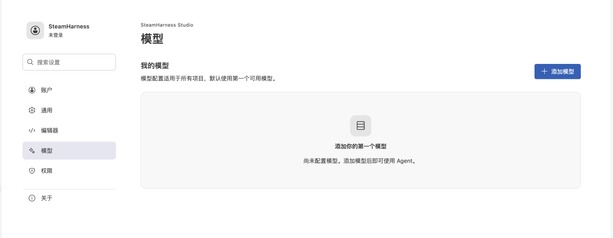

# 配置模型

在 **设置 → 模型** 中管理跨工作区使用的模型。开源版使用自定义模型，密钥保存在本机安全存储中。

在设置的模型页添加自定义模型。

## 添加与选择

1. 打开 **设置 → 模型**，或点击小助手中的 **配置模型**。
2. 添加自定义模型，填写服务商、连接地址及所需凭据。
3. 保存后回到模型菜单，选择可用模型。
4. 根据模型支持的能力单独选择思考强度（effort）。

没有可用模型时，小助手显示配置入口；配置完成后恢复模型列表。小助手默认使用第一个允许的模型，也可以将任意可用模型设为默认值。

## 编辑与生效时机

| 操作 | 行为 |
| --- | --- |
| 添加、编辑或删除自定义模型 | 在模型表格中操作 |
| 弹窗键盘操作 | Tab 切换字段，Esc 取消 |
| 任务运行中打开设置 | 可以编辑，当前任务继续使用原快照 |
| 保存新配置 | 当前及后台任务结束、会话空闲后生效 |
| 多窗口修改冲突 | 重新打开编辑器，基于最新数据修改 |

模型表格按模型、服务商和操作组织；窄窗口只让表格横向滚动。模型与 effort 是两个独立选项。

## 系统模型

支持系统 AI 的宿主会加载当前账号可用的模型，并按内置、自定义分组。内置模型可刷新和设为默认值，不能手工编辑或删除。

切换账号会清除旧目录；普通刷新失败保留当前列表并提供重试。系统 AI 的开通和使用见[增强版指南](https://docs.steamharness.yuhe.space/enhanced/ai/user-guide)。

## 排查

- 列表为空：检查自定义模型配置，或确认账号是否有系统模型权限。
- 新设置没有影响当前回复：等待当前及后台任务完成后再发送。
- 模型不在项目允许范围：检查项目的模型来源和用户设置声明。

开发者接入规则见[用户设置与权限继承](/core-api/user-settings)和 [LLM Provider](/concepts/llm-provider)。
