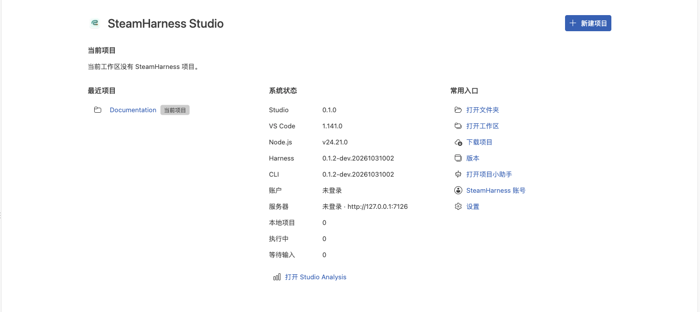

# Studio 工作站

Studio 是用于编辑和运行 SteamHarness 项目的工作站。初次使用先完成[快速开始](/guides/quickstart)，再按当前任务选择下方指南。

Studio 开始页：项目、最近记录和常用入口。

## IDE 与 Steam 模式

切换 IDE 与 Steam 布局，管理工具实例、文件和快捷键。

[查看操作步骤](/guides/studio/interface)

## 开始工作台

从模板创建项目，或通过目录、工作区和分享链接导入。

[查看操作步骤](/guides/studio/create-import)

## 打开 Workflow 项目

点击运行项目，选择入口和参数，再从 Trace 查看结果。

[查看操作步骤](/guides/studio/run-debug)

## 聚合入口与数据库

先取得资源授权并完成入口绑定，再使用关系库或知识库。

[查看操作步骤](/guides/studio/data)

## 上传、下载与版本

以整个项目为单位上传发布，或下载指定版本。

[查看操作步骤](/guides/studio/versions)

## 本地分析

筛选本机项目与运行记录，查看状态、成功率和耗时。

[查看操作步骤](/guides/studio/analysis)

## 账号与服务器

选择 Server 并登录，检查项目身份、归属和有效权限。

[查看操作步骤](/guides/studio/configuration)

## 源码运行

安装依赖、构建并启动桌面或浏览器工作站。

[查看操作步骤](/guides/studio/installation)

## 项目配置

选择命名配置、编辑字段，导入导出配置。

[查看操作步骤](/guides/studio/configuration)

## 模型设置

添加模型、选择默认值，并了解设置的生效时机。

[查看操作步骤](/guides/studio/models)

## 小助手与权限

使用技能、控制工具和持久任务，查看权限与子 Agent。

[查看操作步骤](/guides/studio/assistant)
