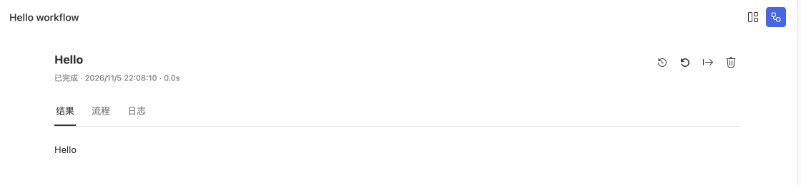

# 运行项目与查看错误

用 **运行项目** 打开项目界面，再选择要执行的入口。Studio 使用项目安装的 `steamharness` 和 `@steamharness/cli`。

Hello 工作流已完成，结果区显示本地输出。

## 运行一次任务

1. 打开项目根目录，确认依赖已安装。
2. 点击窗口顶部或开始页中的 **运行项目**。
3. Workflow 选择操作、填写参数并运行；Bot 输入消息；Kanban 打开页面。
4. 检查输出与状态，需要诊断时打开 Trace。

后台检查正常时不显示提示。只有失败才显示处理引导和 **重新检查**；修复后通过检查，提示会消失。

## 打开其他入口

开始页一张卡片代表一个聚合项目，默认打开 `defaultEntry`。运行界面的 **项目窗口** 图标会列出全部入口及其状态。

点击入口右侧的打开图标，每次都会新建标签，也可以重复打开当前入口。标签独立保存页面状态和草稿，重启后可恢复；同一项目复用宿主进程，最后一个原生标签关闭后才释放宿主。

左侧 **打开项目窗口** 只列当前项目。切换工具不会改变列表，修改声明后自动刷新，也可手动刷新。标题采用“项目名称 / 入口名称”，版本属于整个项目。

## 阅读 Trace

| 要查什么 | 操作 |
| --- | --- |
| 节点输入、输出与日志 | 打开执行轨迹并选择相应节点 |
| 模型或工具失败 | 在 **错误** 分类按会话、轮次和关键词筛选 |
| 任务树与子对话 | 在任务页签选择任务或打开子会话 |
| 上下文与用量 | 查看用量页签，或悬停输入栏右侧上下文圆环 |

模型重试成功后仍保留先前的错误诊断。选择 Trace 历史不会切换正文，眼睛标记指向编辑区实际打开的对话。

参数、附件或资源打开失败时，错误继续显示在对应位置；关闭提示不跳过参数校验。输入区较矮时，长文本和附件在内部滚动，发送按钮仍可见。

## 关闭与恢复

历史记录可以在重新打开项目后读取。普通运行的关闭与停止行为由对应宿主管理；持久 Agent 会保存检查点，显式停止才持久取消，见[小助手与持久任务](/guides/studio/assistant)。

诊断数据库问题时，先检查[资源授权与入口绑定](/guides/studio/data)。上传成功或文件能下载不代表页面已经渲染成功，应直接打开 Kanban 确认内容。
